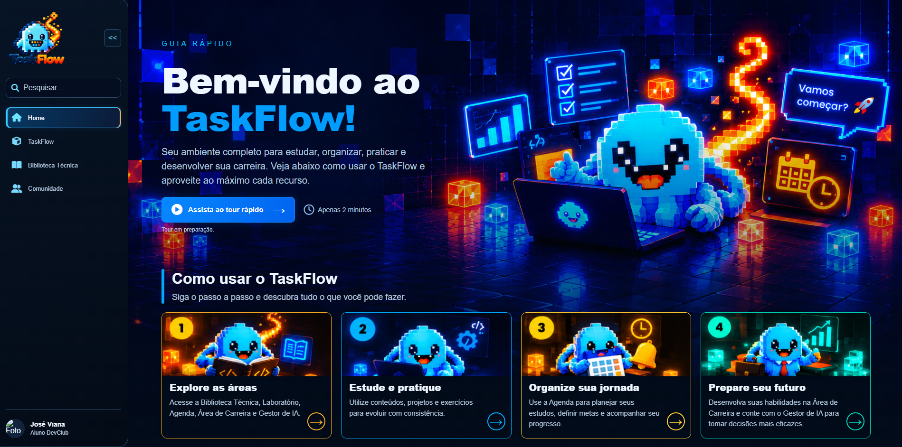
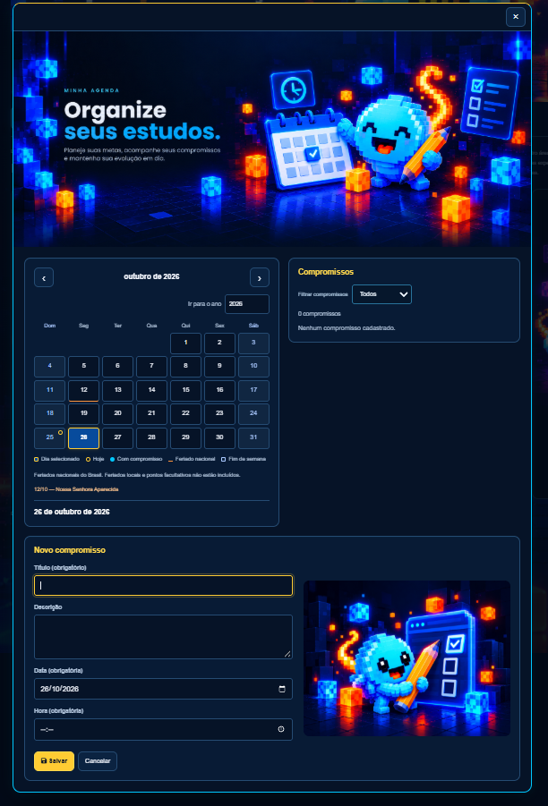
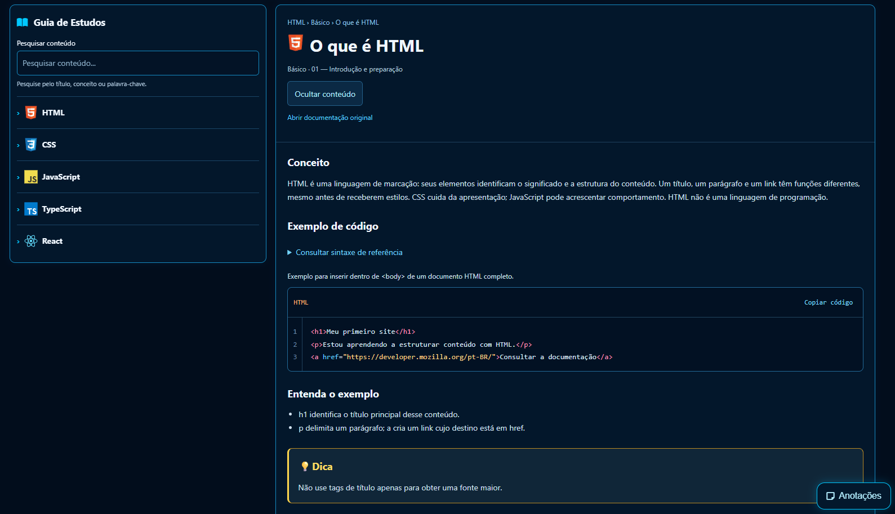
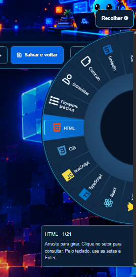
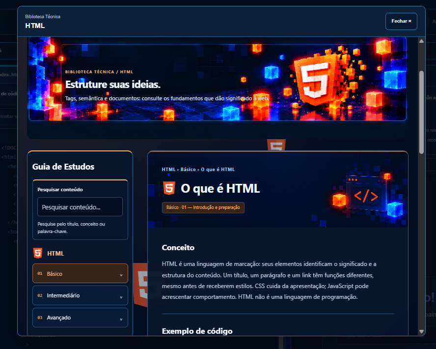
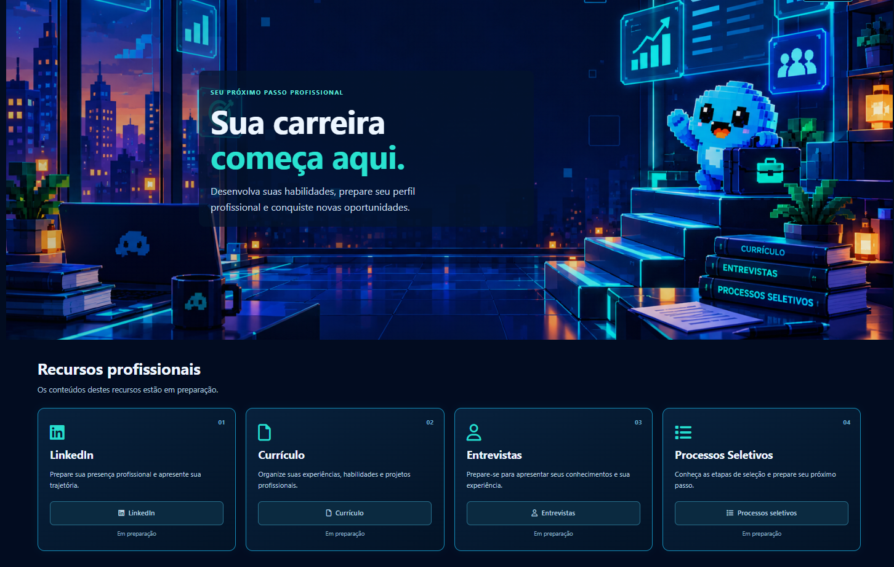

# TaskFlow

### Estude. Organize. Desenvolva.

O **TaskFlow** é uma plataforma educacional desenvolvida para reunir **organização, aprendizado e prática de programação em um único ambiente**.

O projeto nasceu de uma dificuldade comum durante o aprendizado de desenvolvimento web: organizar os estudos, consultar documentações, acompanhar compromissos e colocar os conhecimentos em prática utilizando diferentes ferramentas.

Pensando nisso, desenvolvi o TaskFlow, uma aplicação que integra recursos de produtividade, materiais de apoio e um laboratório de programação diretamente no navegador.

Desenvolvido com **HTML5, CSS3 e JavaScript**, o projeto representa um MVP criado para o **Concurso de Projetos do DevClub**, com foco na experiência do usuário, na organização do código e na construção de funcionalidades reais.

---

## 🌐 Live Demo

Acesse a versão publicada do TaskFlow:
### [Acessar TaskFlow — GitHub Pages](https://pabliciosousa49-lang.github.io/TaskFlow-DevClub/)

---

## 🖼️ Apresentação do Projeto


<p align="center">
    
    
</p>
---

## 💡 Problemática e Objetivo

Durante o processo de aprendizagem em programação, é comum utilizar diferentes ferramentas para estudar, consultar conteúdos, organizar atividades e desenvolver projetos.

Essa separação pode dificultar a organização da rotina e interromper o fluxo de aprendizagem.

O **TaskFlow** foi desenvolvido com a proposta de concentrar essas atividades em uma única plataforma.

Seu objetivo é oferecer ao estudante um ambiente onde seja possível:

- Organizar compromissos e atividades.
- Gerenciar sessões de estudo.
- Consultar materiais técnicos.
- Praticar programação.
- Criar e testar projetos.
- Acompanhar o próprio desenvolvimento.

A proposta não é substituir ferramentas profissionais, mas oferecer um ambiente complementar para **estudar, praticar e desenvolver**.

---

## 🚀 Funcionalidades

### 🏠 Home

A página principal apresenta a plataforma e facilita o acesso às suas funcionalidades.

**Recursos:**

- Apresentação do TaskFlow.
- Guia inicial de utilização.
- Navegação entre as áreas.
- Acesso às ferramentas de estudo e desenvolvimento.
- Interface responsiva com identidade visual própria.

<p align="center">
    
</p>

### ⏱️ Pomodoro

Ferramenta de gerenciamento de tempo voltada à organização das sessões de estudo.

**Recursos:**

- Cronômetro de foco.
- Intervalos de descanso.
- Configuração de duração.
- Controles de execução.
- Alertas.
- Visualização minimizada.
- Estatísticas de utilização.

<p align="center">
    
    
</p>

### 📅 Agenda

Ambiente para organizar compromissos e acompanhar atividades.

**Recursos:**

- Cadastro de compromissos.
- Calendário.
- Listagem de atividades.
- Filtros de organização.
- Acompanhamento de próximos eventos.
- Gerenciamento dos compromissos registrados.

<p align="center">
    
</p>

### 📚 Biblioteca Técnica

Área destinada à consulta de conteúdos de programação.

Os materiais são organizados por linguagem e tópicos, permitindo que o estudante consulte explicações e exemplos durante seu aprendizado.

**Recursos:**

- Conteúdos técnicos por linguagem.
- Materiais de HTML, CSS, JavaScript e outras tecnologias disponíveis.
- Organização por tópicos.
- Pesquisa de conteúdos.
- Exemplos de código.
- Documentações de referência.
- Anotações locais.

A Biblioteca Técnica funciona como um material de apoio para estudo e consulta.

<p align="center">
    
</p>

### 💻 Laboratório — TaskFlow Studio

O **Laboratório** é uma das principais funcionalidades do TaskFlow.

Ele permite que o usuário desenvolva projetos diretamente pelo navegador, utilizando um ambiente de edição com arquivos, pastas e pré-visualização.

**Recursos:**

- Criação de projetos.
- Gerenciamento de projetos existentes.
- Criação de arquivos e pastas virtuais.
- Editor de código.
- Desenvolvimento com HTML, CSS e JavaScript.
- Organização de arquivos em abas.
- Sugestões durante a escrita.
- Busca e navegação entre arquivos.
- Pré-visualização da aplicação.
- Console e diagnósticos.
- Testes de funcionalidades.
- Identificação e correção de erros.
- Salvamento local dos projetos.
- Recursos de backup e recuperação.

O ambiente também oferece ferramentas auxiliares de aprendizagem.

**Documentação e exemplos de código**

Durante o desenvolvimento, o usuário pode consultar materiais técnicos e exemplos para auxiliar na compreensão de conceitos e na resolução de dúvidas.

**Roleta de recursos**

A roleta oferece uma dinâmica de exploração de conteúdos e atividades, incentivando a prática de programação.

**Exportação de projetos**

O Laboratório permite trabalhar com projetos que podem ser transferidos para ambientes externos, conforme os formatos de exportação disponíveis na versão utilizada.

O objetivo é aproximar o estudante da experiência de desenvolver uma aplicação, testar seu funcionamento e compreender a conexão entre os arquivos.

<p align="center">
    
    
    
    
</p>

### 👨‍💼 Carreira

Área voltada à preparação profissional de estudantes e desenvolvedores.

A proposta contempla conteúdos relacionados a:

- LinkedIn.
- Currículo profissional.
- Entrevistas.
- Processos seletivos.
- Desenvolvimento de carreira.

**Observação:** parte dos recursos dessa área permanece em preparação.

<p align="center">
    
</p>


---

## 🛠️ Tecnologias Utilizadas

| Área | Tecnologias |
|---|---|
| **Frontend** | HTML5, CSS3 e JavaScript |
| **Editor de código** | CodeMirror 6 |
| **Análise de sintaxe** | Parsers Lezer |
| **Armazenamento** | Armazenamento local do navegador |
| **Interface** | CSS responsivo |
| **Ícones** | Devicon e Font Awesome |
| **Versionamento** | Git e GitHub |
| **Publicação** | GitHub Pages e GitHub Actions |
| **Testes** | Node.js Test Runner e testes automatizados |

O TaskFlow foi desenvolvido com foco em JavaScript, sem necessidade de um framework de frontend ou backend próprio para executar a plataforma.

Alguns recursos externos, como bibliotecas do editor e ícones, dependem de conexão com a internet.

---

## 🏗️ Arquitetura do Projeto

O TaskFlow utiliza uma organização modular, separando interface, funcionalidades, serviços, conteúdos educacionais e documentação.

```text
TaskFlow-DevClub/
│
├── index.html
│
├── pages/
│   ├── studio.html
│   └── demais páginas
│
├── css/
│   ├── global/
│   ├── components/
│   └── pages/
│
├── js/
│   ├── core/
│   ├── modules/
│   ├── services/
│   ├── utils/
│   └── biblioteca/
│
├── data/
│   └── biblioteca/
│
├── assets/
│   └── images/
│
├── docs/
│   └── arquitetura.md
│
├── tests/
│
├── .github/
│   └── workflows/
│
└── README.md
```

### Responsabilidade dos diretórios

| Diretório | Responsabilidade |
|---|---|
| `pages/` | Páginas e interfaces específicas. |
| `css/` | Estilização global, componentes e páginas. |
| `js/core/` | Inicialização e navegação da aplicação. |
| `js/modules/` | Funcionalidades independentes da plataforma. |
| `js/services/` | Serviços e gerenciamento de dados. |
| `js/utils/` | Funções auxiliares. |
| `js/biblioteca/` | Recursos da Biblioteca Técnica. |
| `data/biblioteca/` | Conteúdos educacionais. |
| `assets/` | Imagens e recursos visuais. |
| `docs/` | Arquitetura e documentação técnica. |
| `tests/` | Testes automatizados. |
| `.github/workflows/` | Automação de publicação. |


---

## 🔄 Fluxo de Funcionamento

O TaskFlow reúne diferentes recursos em uma interface de navegação integrada.

```text
Usuário
   │
   ▼
Interface TaskFlow
   │
   ├── Home
   │
   ├── Pomodoro
   │
   ├── Agenda
   │
   ├── Biblioteca Técnica
   │
   ├── Laboratório
   │      │
   │      ▼
   │   Criação do projeto
   │      │
   │      ▼
   │   Arquivos e pastas
   │      │
   │      ▼
   │   Editor de código
   │      │
   │      ▼
   │   Pré-visualização
   │      │
   │      ▼
   │   Testes e correções
   │      │
   │      ▼
   │   Salvamento local
   │      │
   │      ▼
   │   Exportação / Backup
   │
   └── Carreira
```

### Funcionamento do Laboratório

O Laboratório utiliza um sistema de arquivos virtuais para organizar os projetos desenvolvidos pelo usuário.
O editor permite trabalhar com arquivos HTML, CSS e JavaScript, enquanto a pré-visualização apresenta o resultado da aplicação em um ambiente isolado.

O sistema também oferece recursos de navegação, diagnósticos e persistência local.
Essa estrutura permite praticar a conexão entre arquivos e compreender o comportamento de uma aplicação web.

---

## 🧠 Metodologia de Desenvolvimento

O TaskFlow foi desenvolvido utilizando uma metodologia estruturada de planejamento, implementação, testes e documentação.
O objetivo foi compreender cada etapa do desenvolvimento e organizar a evolução do projeto.

### Planejamento

**Problema → Objetivo → MVP → Roadmap → Arquitetura**

Antes de iniciar a implementação, foram definidos o problema que o projeto deveria resolver, seus objetivos e a organização inicial da aplicação.

### Desenvolvimento

**Planejar → Implementar → Testar → Code Review → Refatorar → Commitar → Documentar**

Cada funcionalidade foi dividida em blocos menores, com responsabilidades específicas.

Essa abordagem permitiu implementar, testar e revisar cada etapa antes de avançar para novas funcionalidades.

### Metodologia de leitura de código JavaScript

Durante o desenvolvimento, utilizei seis categorias para compreender a responsabilidade dos trechos de código.

| Categoria | Responsabilidade |
|---|---|
| **Observação** | Compreender o comportamento esperado. |
| **Seleção** | Identificar elementos e dados necessários. |
| **Escuta** | Reconhecer eventos e interações. |
| **Processamento** | Executar a lógica da aplicação. |
| **Condição** | Validar regras e determinar o fluxo. |
| **Atualização** | Modificar dados, estados ou elementos da interface. |

Essa metodologia contribui para compreender não apenas **o que o código faz**, mas também **por que ele existe e qual responsabilidade exerce na aplicação**.

---

## 📚 Documentação

A documentação faz parte do processo de desenvolvimento do TaskFlow.
As etapas são registradas considerando três pontos principais:

- **Objetivo:** o que foi planejado e implementado.
- **Desafios:** dificuldades encontradas durante o desenvolvimento.
- **Conclusão:** resultados e aprendizados da etapa.

O Git e o GitHub são utilizados para acompanhar a evolução do projeto por meio de commits relacionados às responsabilidades implementadas.

## 🚀 Como Executar o Projeto

### Pré-requisitos
- Navegador atualizado.
- Visual Studio Code ou outro editor.
- Servidor HTTP local, como Live Server.

### 1. Clone o repositório

```bash
git clone https://github.com/pabliciosousa49-lang/TaskFlow-DevClub.git
```

### 2. Acesse a pasta

```bash
cd TaskFlow-DevClub
```

### 3. Abra no VS Code

```bash
code .
```

### 4. Execute a aplicação

Utilize a extensão **Live Server** para iniciar a aplicação pelo arquivo `index.html`.

Como alternativa, caso tenha Python instalado, execute na raiz do projeto:

```bash
python -m http.server 8000
```

Depois, acesse:

http://localhost:8000

**Importante:** utilize um servidor HTTP local. Abrir o arquivo diretamente pelo protocolo `file://` não é o fluxo recomendado para o funcionamento dos módulos e recursos da plataforma.

---

## 🧪 Como Utilizar o Laboratório

O Laboratório permite desenvolver aplicações web diretamente pelo navegador.

Um exemplo de utilização é a criação de uma aplicação simples de login com navegação para um dashboard.

### 1. Crie um projeto

Acesse o Laboratório e crie um novo projeto.

### 2. Organize os arquivos

```text
Projeto-Login/
│
├── index.html
├── dash.html
├── style.css
└── script.js
```

### 3. Conecte os arquivos

No `index.html`, utilize as referências:

```html
<link rel="stylesheet" href="./style.css">
<script src="./script.js" defer></script>
```

### 4. Desenvolva a aplicação

Crie uma interface de login utilizando HTML e CSS.

Implemente a interação do botão de entrada utilizando JavaScript.

### 5. Teste a navegação

No ambiente do Laboratório, utilize os recursos de navegação virtual disponibilizados pelo TaskFlow, quando necessário.

Exemplo:

```javascript
TaskFlow.navegar("./dash.html");
```

Esse recurso permite navegar entre arquivos HTML do projeto dentro da pré-visualização do Laboratório.

### 6. Teste e corrija

Utilize a pré-visualização e os diagnósticos para acompanhar o comportamento da aplicação.

### 7. Salve e exporte

Salve o projeto e utilize as opções de exportação ou backup disponíveis na versão atual.

Ao trabalhar com uma exportação ZIP, os arquivos podem ser extraídos e abertos em um editor externo, como o VS Code.

No navegador convencional, a navegação poderá utilizar caminhos relativos ou outros mecanismos nativos apropriados.

---

## 🧪 Testes e Validação

O TaskFlow possui testes automatizados para validar comportamentos e responsabilidades específicas da aplicação.
Entre os recursos testados estão funcionalidades relacionadas ao Laboratório, à resolução de caminhos e à pré-visualização.

### Executar os testes

Com Node.js 24 ou superior, execute na raiz do projeto:
```bash
node --experimental-vm-modules --test tests/*/*.test.mjs
```

Os testes utilizam ambientes simulados e recursos locais de teste.
A validação manual em navegador continua importante para verificar:

- Navegação entre páginas.
- Funcionamento do editor.
- Pré-visualização.
- Persistência de projetos.
- Exportação e recuperação.
- Responsividade.
- Funcionamento na versão publicada.

---

## ⚠️ Limitações e Futuras Implementações

O TaskFlow é um MVP em evolução.
Algumas limitações e características atuais incluem:

- Armazenamento de projetos no navegador.
- Ausência de sincronização em nuvem.
- Ausência de autenticação de usuários na plataforma principal.
- Restrições de segurança na pré-visualização do Laboratório.
- Dependência de recursos externos para determinadas bibliotecas.
- Funcionalidades da área de Carreira ainda em preparação.
- Recursos de Comunidade e Gestor de IA sem integração funcional completa.

O objetivo é evoluir a plataforma de maneira incremental, preservando sua proposta educacional.

---

## 🎯 Objetivo Profissional

O TaskFlow faz parte do meu processo de desenvolvimento como programador, permitindo aplicar conhecimentos de **Frontend, JavaScript, arquitetura de software, organização de código, testes e documentação técnica**.

Durante sua construção, trabalhei com problemas relacionados à navegação entre arquivos, persistência de dados, pré-visualização de aplicações, modularização e experiência do usuário.

O projeto também representa minha metodologia de aprendizagem: utilizar a inteligência artificial como ferramenta de apoio ao desenvolvimento, mantendo o foco na compreensão do código, nas decisões técnicas e na resolução dos problemas encontrados.

Mais do que concluir um MVP, a proposta foi transformar uma necessidade identificada durante meus estudos em uma aplicação funcional, documentada e em constante evolução.

---

## 👨‍💻 Desenvolvedor

**José Pablicio Sousa Viana**

Desenvolvimento Front-End | Desenvolvimento de Software
Acadêmico de Análise e Desenvolvimento de Sistemas, com foco em desenvolvimento Full-Stack.

<p align="center">
  <a href="https://www.linkedin.com/in/pablicio-sousa-6554462a0/">
    LinkedIn
  </a>
  &nbsp; | &nbsp;
  <a href="https://github.com/pabliciosousa49-lang">
    GitHub
  </a>
</p>

---

<p align="center">
  <strong>TaskFlow — Estude. Organize. Desenvolva.</strong>
</p>
